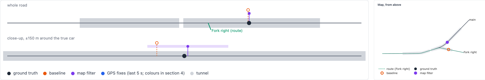

# Positioning a car through a GPS-denied tunnel

Code, README and run instructions: [github.com/acevizli/TunnelSimulator](https://github.com/acevizli/TunnelSimulator). Every decision, with its reasoning, is recorded on the map issue: [Tunnel positioning](https://github.com/acevizli/TunnelSimulator/issues/1).

## Approach

Two estimators get exactly the same sensor data, so any difference between them comes from the method.

The **baseline** is what a GPS-only navigation app does. When GPS drops out, it keeps moving the car along the planned route at the last speed GPS reported.

The **map filter** is the proposed approach, described below.

### One number along the road

In a single-lane tunnel the car can only be on the road, so its position comes down to one number: how many metres along the road it is. That number is also all an exit callout needs. The map filter therefore estimates distance along the known road rather than a position in 3D. A 3D inertial solution on phone sensors drifts by hundreds of metres to kilometres over a 5 km tunnel, and the sideways accuracy it would add is no use with one lane ([ADR 0001](https://github.com/acevizli/TunnelSimulator/blob/main/docs/adr/0001-map-constrained-1d-ekf.md)).

It is a Kalman filter. It keeps a best guess for each quantity together with how unsure it is, moves the guess forward with the motion sensors, and pulls it back when a measurement disagrees, trusting each source according to how noisy it is. Besides distance and speed, it learns the sensor errors that would otherwise make the distance drift:

- the accelerometer's bias, a constant offset in its forward reading;
- the gyroscope's bias, and its scale error (it reads every turn rate slightly off);
- the yaw of the phone in its holder: how far the phone's idea of "forward" is turned from the car's.

### What happens every 0.1 s

1. **Predict.** The forward acceleration the phone measures moves the speed and distance on, after removing the learned bias and the share of gravity that the road's slope (known from the map) leaks into the reading.
2. **Stops.** A standing car has almost no road vibration. When the vibration disappears, the filter sets the speed to zero. Without this, a small accelerometer bias keeps "driving" the car forward through every stop in a traffic jam.
3. **Curves.** In a curve, the gyroscope's turn rate equals speed times the road's curvature, which the map knows. So a curve measures speed. On a straight the expected turn rate is zero, so whatever the gyroscope reads there is its bias.
4. **Slopes.** On a slope, the barometer's climb rate equals speed times the road's grade, so a slope measures speed as well.
5. **Landmarks.** When the gyroscope or barometer sees a curve start or end, or a change of slope, and the map has one nearby, that fixes the position itself, not only the speed.

Each check carries its own noise, and the filter weighs it against how unsure its current guess is. The output is a position with an uncertainty band (±2σ) that widens while there is nothing to check against and narrows at each curve, slope or landmark.

### Before the tunnel, and back to GPS

Before the tunnel GPS is still good. The filter uses it to work out how the phone sits in the car and to learn both sensor biases, so it enters the tunnel with those errors already measured. At the entrance it redoes this alignment with everything recorded so far and replays the drive with it. A phone that turns in a loose holder shows up as a rotation the car itself cannot make; the filter follows it with the gyroscope and stops trusting the bias it had learned.

Inside the tunnel GPS is not used at all. Near a portal, fixes are often wrong in ways the phone does not report: some bounce off the walls, and some are positions the phone extrapolates on its own. After the exit, GPS is trusted again only once three fixes outside agree with each other, and the shown position then slides over to it instead of jumping. Ten agreeing fixes overrule the filter however sure it is, so it cannot stay stuck on a wrong belief.

### Exits: following both branches

Where the road splits, the car could go either way, and there is no GPS to say which. Shortly before the uncertainty band reaches a split, the filter starts a copy of itself that assumes the other branch (a branch hypothesis). Both copies get every sensor reading. At every step each copy is scored on how well its own branch's map explains what the gyroscope and barometer just measured: a branch that bends left predicts a left turn, a branch that climbs predicts rising height. A copy a hundred times less likely than the best is dropped. Before there is any evidence, the branch on the planned route is slightly favoured. The position shown is the most likely copy's.

A missed exit is called when the estimate is past the split on another branch and the copy for the route's branch has been dropped.

### Callouts

"Exit in 400 m" and "exit in 100 m" are said when the cautious edge of the band (estimate + 2σ, the furthest along the car plausibly is) reaches that distance before the exit. The less certain the filter is, the earlier the callout comes.

### Add-ons

Two optional sources, each run as a separate copy of the map filter so its gain over the phone alone can be measured:

- The car's own speed reading, through an OBD dongle, Android Auto or CarPlay. It reads a few percent off, so the filter learns its scale and offset against GPS before the tunnel and holds them fixed inside, where nothing reliable is left to learn them from.
- Tunnel beacons every 35 m. Each beacon heard is a position fix, checked against the prediction like GPS. A beacon on another branch moves the estimate onto that branch.

## Assumptions

- An accurate offline road map: centreline, curvature, grade, tunnel extent, exits. A wrong map is a failure, not a handled case.
- Native app: accelerometer and gyro 100 Hz, barometer 25 Hz, GPS 1 Hz. The magnetometer is simulated but unused (the car body distorts it).
- One fixed "typical" phone, numbers from datasheets and measured phones: accelerometer bias 20 mg, gyro bias 0.25 °/s, scale error 0.75 %, barometer 1 Pa noise plus drift. Not tuned to make the method look good.
- Phone in a mount at an unknown angle, or loose (one 20° shift mid-tunnel).
- Every drive starts cold: nothing carried over from earlier drives, since the phone may be in another car.
- One car; traffic only shapes its speed. Car speed reads 3 % + 0.3 m/s high; 5 % of beacon passes go unheard.

## What was simulated and how

A Python core computes a whole seeded run; a web page replays it: the true car next to every estimate on the road and a map from above, error over time with the ±2σ band, speed, what the driver hears, the raw sensor traces, and every metric (each worst value jumps to its moment). A scenario editor changes any piece and reruns.

- **Roads**, five shapes modelled on real tunnels: straight 2–5 km (Fort McHenry), long 5 % grade with an exit (Södra länken), two exits 400 m apart (Boston I-93), dip and fork after a 100 m open gap (Oslo Opera Tunnel), 35 m-radius 10 % spiral (Drammen).
- **Speed profiles**: free flow, slowdown at entry, stop-and-go, full stop, speed change inside, each with seeded wobble. The car can miss its planned exit.
- **Sensors** derived from the true motion: IMU with bias, bias wander, scale error, gravity through the mount angle, road vibration that vanishes when stopped; barometer with drift. **GPS at the portals** in 8 phases: open sky, fading, fixes bouncing off walls, fake "coasting" fixes, dark, reacquiring, biased first fixes, optimistic accuracy. All sensor data passes through one `SensorSource` interface so a recorded or live phone can replace the simulator.
- **Evaluation**: 8 test scenarios × 20 seeds, `uv run tunnelsim-measure` → [results/measurements.md](https://github.com/acevizli/TunnelSimulator/blob/main/results/measurements.md). Measured, not graded.

## Results: largest error inside the tunnel, median / 95th percentile over 20 seeds

| Scenario | Baseline | Map filter | With add-on |
|---|---|---|---|
| 1 · Straight 2 km, free flow | 35 / 61 m | 7.2 / 20 m | |
| 2 · Straight 5 km, stop-and-go | 4248 / 4329 m | 23 / 54 m | |
| 3 · Two exits, slowdown | 665 / 713 m | 12 / 27 m | |
| 4 · Fork, missed exit | 4999 / 4999 m | 14 / 26 m | |
| 5 · Long grade, loose phone | 70 / 137 m | 9.0 / 20 m | |
| 6 · Spiral | 879 / 991 m | 6.7 / 23 m | |
| 7 · Long grade, speed change | 938 / 1024 m | 10 / 16 m | car speed: 4.3 / 6.7 m |
| 8 · As 2, different seeds | 4248 / 4329 m | 15 / 50 m | beacons: 8.2 / 10 m |

- **Callouts**: the map filter's are mostly 10–34 m early (the cautious edge), worst 11 m late. The baseline's in scenario 3 came 440–730 m late, after the car had passed the exit, because it kept "driving" through the slowdown.
- **Branches**: the correct branch in all 80 runs with a split, decided 6–12 m past it. The missed exit is called 11–12 m past the split; the baseline calls it 2.7 km later.
- **Exit**: the map filter is within 10 m of the car 0–8 s after the exit; the baseline takes up to 66 s (once never) and jumps by up to 5 km when GPS returns.

## Where it breaks, and why

- **Straight, flat, long tunnel with stops** (2, 8): nothing on the road to recognise, so the error grows with distance from the accelerometer's residual bias and the pull-aways: worst 67–78 m over 5 km. Beacons bound it (worst 13 m).
- **Too confident in the spiral** (6): the car is inside the band only 78 % of the time at the 95th percentile, worst 66 %, at the spiral's exit. The cause is not isolated yet; the suspect is gyro scale error in a long tight curve, where turn rate sets the speed.
- **Tunnel entrance**: the band is least honest here (bounced and coasting GPS fixes). With car speed learned at one speed only, the car is inside the band 65 % of the time at the 95th percentile.
- **Branch decisions** need branches whose curves or slopes differ. The simulated car changes curvature instantly, so on a real road the decision comes later than the ~0.5 s measured; two branches with the same shape cannot be told apart without beacons.

## Limitations

All numbers come from our own sensor models, built from datasheets and literature; they are only as good as those models (barometer drift in tunnel ventilation and the cabin's magnetic disturbance are unverified). One phone quality, one loose-phone event, no handling of the phone by the driver, no rerouting after a missed exit.

## Next, with real devices

1. Record real drives (raw IMU, barometer, GNSS, and car speed over OBD) through real tunnels, with a reference: a high-grade GNSS/INS, or marked tunnel landmarks timed on video. Replay them through `SensorSource`.
2. Refit the sensor and portal-GPS models to those recordings and re-run the measurement; check whether the ranking holds.
3. Port the filter to the phone (Kotlin/Swift) and check real sensor timestamps, rates, latency and battery.
4. Fix the spiral and entrance over-confidence; test mounts, pockets and cup holders; find out which tunnels already have beacons.

## AI usage

The work was driven with Claude Code and coordinated entirely through GitHub issues: the [map issue](https://github.com/acevizli/TunnelSimulator/issues/1) holds the goal and an index of decisions, and each research question, decision and build step is a child issue whose resolution comment records what was decided, any deviation from the plan, and the findings. The AI wrote the four research notes (`research/`), put each decision as numbered questions with a recommendation, wrote the code, tests and pages, and ran the measurements; every question was answered and every merge approved by hand. Where the AI was corrected or overruled (outcomes on the linked issues):

- **Car-speed error**: a single scale factor was proposed; real speedometers read further off at high speed, so it became scale + offset with an optional non-linear term ([#5](https://github.com/acevizli/TunnelSimulator/issues/5), [#17](https://github.com/acevizli/TunnelSimulator/issues/17)).
- **Learning across drives** was proposed for the car-speed calibration; overruled, every drive starts cold ([#5](https://github.com/acevizli/TunnelSimulator/issues/5)).
- **Good/typical/poor phone presets and pass/fail thresholds** were proposed; replaced by one fixed typical phone and metrics without thresholds ([#9](https://github.com/acevizli/TunnelSimulator/issues/9), [#10](https://github.com/acevizli/TunnelSimulator/issues/10)).
- **Error metric**: in the fork scenario the baseline looked better than the map filter. Review showed the metric hid estimates on the wrong branch; it now counts road distance through the split ([#10](https://github.com/acevizli/TunnelSimulator/issues/10), [#15](https://github.com/acevizli/TunnelSimulator/issues/15)).
- **Corrected by measurement**: learning the car-speed calibration inside the tunnel looked more accurate but left the car inside the band 1 % of the time, so it is held fixed; the scenario predicted to fail with car speed (7) did not ([#17](https://github.com/acevizli/TunnelSimulator/issues/17)).
- **Page and process**: a duplicated metrics section dropped and the estimator descriptions restored ([#12](https://github.com/acevizli/TunnelSimulator/issues/12)); a pull request stacked on a feature branch had to be landed again ([#14](https://github.com/acevizli/TunnelSimulator/issues/14)).
